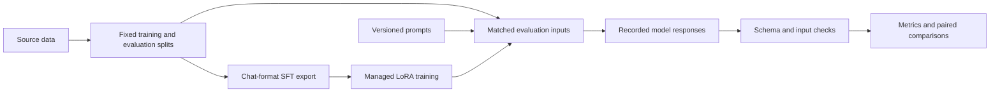

# Prompt or Tune

**A recorded comparison of prompt engineering and LoRA for structured classification**

I built this project to work through a practical question: when is fine-tuning
worth the extra work if the prompt can still be improved?

I started with a small support-ticket router, where clearer policy instructions
worked better than the adapter I trained. I then moved to BANKING77, a public
77-intent banking dataset. LoRA helped there, but the original prompt only listed
label names. I followed up with explicit label definitions to see how much of the
advantage remained against a stronger base-model prompt.

On a separate 385-query confirmation sample, the stronger prompt raised base
accuracy from **66.5% to 76.4%**. The existing LoRA model reached **82.6%** with
either prompt. Fine-tuning retained a **6.2-point advantage** in that comparison.

This repository includes the evaluation code, all **9,456 scored predictions**
across 14 complete runs, the data splits, and an offline command to check the
results. Model weights are not included.

## Results

The follow-up used the same 385 confirmation inputs for all four configurations.
Those queries came from the unused part of the publisher's training split and
were excluded from this project's SFT and prompt construction.

| Confirmation configuration | Correct | Intent accuracy |
| --- | ---: | ---: |
| Base + label-only prompt | 256/385 | 66.5% |
| Base + label definitions | 294/385 | 76.4% |
| LoRA + label-only prompt | 318/385 | **82.6%** |
| LoRA + label definitions | 318/385 | **82.6%** |

Definitions corrected 45 base-model mistakes and introduced seven new ones.
The tuned model's unchanged score also hides movement: 15 corrections and 15
regressions. I kept the individual predictions so those trade-offs remain visible.

The earlier official-test comparison used 3,080 different queries:

| Official test, identical label-only prompt | Correct | Intent accuracy |
| --- | ---: | ---: |
| Base Qwen3 4B | 2,097/3,080 | 68.1% |
| LoRA Qwen3 4B | 2,680/3,080 | **87.0%** |

The 87.0% and 82.6% figures belong to different samples, so that difference alone
cannot establish a change in model quality. The confirmation sample comes from
the same public dataset, and only one definitions prompt was tested.

[Full results](docs/results.md) · [Methodology](docs/methodology.md) ·
[Limitations](docs/limitations.md)

## What changed my interpretation

One label, `get_physical_card`, covers PIN-related requests in this dataset.
Its name alone is a poor description of those examples. Explicit definitions
improved base confirmation performance for that label from 0/5 to 4/5. That
made the first fine-tuning result less simple: some of the benefit could come
from learning conventions missing from the prompt.

The stronger prompt narrowed the gap, but did not close it. Among the tested
configurations, I would keep the existing LoRA adapter with the original prompt:
it tied the best confirmation score and used about one quarter as many input
tokens as the definitions prompt (208,282 versus 852,772). These token counts
do not establish a dollar-cost saving or a latency advantage.

The earlier support experiment led to a different decision. With the same
explicit-policy prompt, base exact match was 51/54 and LoRA was 50/54. A later
prompt reached 54/54 after I had inspected those examples. I treat that last
number as a development result, not an independent generalization result.

## What I built

I built the data preparation and evaluation code around Fireworks-managed
training and serving. The repository includes SFT export, versioned prompts,
inference runners, JSON validation, scoring, and paired comparisons. A later
review added retry records and checks for malformed outputs and mismatched
comparisons.

Qwen supplied the pretrained model. Fireworks ran the LoRA training jobs; this
repository retains their reported configuration and results.



[Architecture and code map](docs/architecture.md)

## Check the results locally

Use Python 3.13 and [uv](https://docs.astral.sh/uv/). From this checkout:

```bash
uv sync --locked --extra dev --python 3.13
uv run --locked prompt-or-tune demo
uv run --locked prompt-or-tune replay --output output/replayed-results.json
uv run --locked prompt-or-tune verify
uv run --locked pytest -q
```

Installation downloads dependencies. The demo, replay, verification, and tests
then run without an API key or network connection. The demo shows a recorded
comparison. Replay recomputes scores and paired intervals from saved outputs;
it does not ask a model to produce the answers again.

Verification also checks file hashes, regenerates BANKING77 splits from the
included source CSVs, and checks the SFT export and confirmation separation.

[Reproduction details](docs/reproduction.md)

## Inspect a correction and a regression

The [label-convention example](examples/label_convention.json) shows a PIN query
that the base model misclassified until it received definitions. The
[regression example](examples/prompt_regression.json) shows a vague exchange-rate
query whose prediction changed away from the dataset's expected label. Both are
views into the complete confirmation runs, not additional test cases.

## Repository guide

| Path | Contents |
| --- | --- |
| `src/fireworks_lab/` | Evaluation, data preparation, clients, and offline portfolio CLI |
| `tests/` | Contract, retry, comparison, and evidence-integrity checks |
| `evaluation/` | Complete scored runs, expected results, prompts, and export provenance |
| `data/` | Synthetic support data and attributed BANKING77 source/derived data |
| `examples/` | Individual cases linked to complete runs |
| `docs/` | Methods, history, results, limitations, and reproduction |
| `experiments/` | Candidate runs, cold-start failures, configurations, and execution records |

[Project history](docs/experiment_history.md) · [Portfolio copy](PORTFOLIO.md)

## Credits and license

Project code is MIT licensed. BANKING77 is by PolyAI and remains under CC BY 4.0,
including the query text reproduced in evaluation files. See
[third-party notices](THIRD_PARTY.md) and [acknowledgments](docs/acknowledgments.md).
